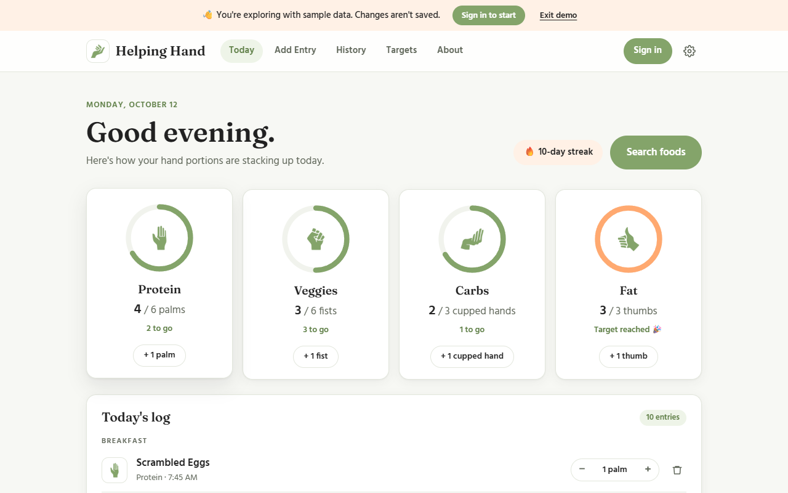
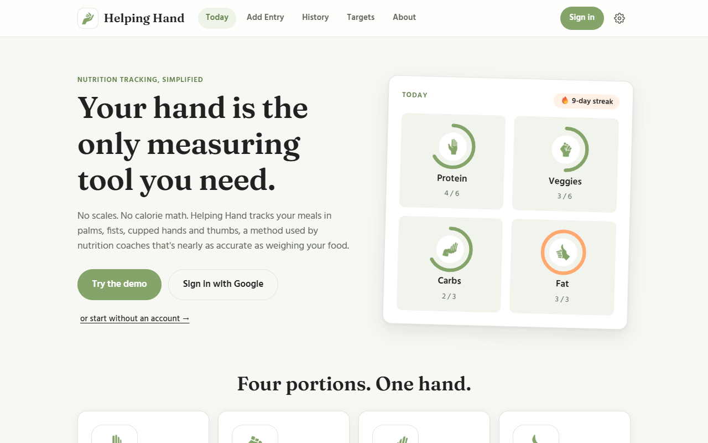
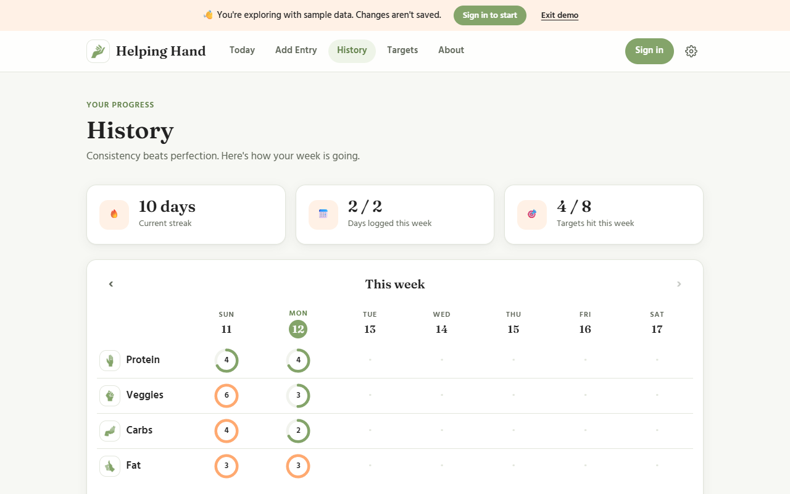
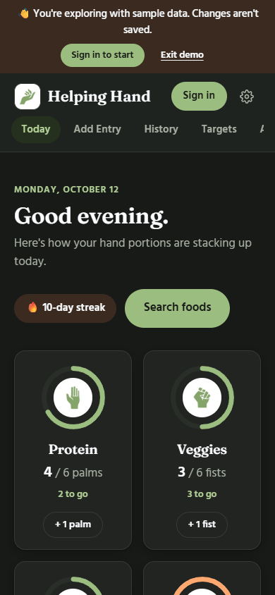

# 🖐️ Helping Hand

**Nutrition tracking without the scale.** Helping Hand tracks meals in hand-sized portions: a palm of protein, a fist of veggies, a cupped hand of carbs, a thumb of fat. It's the method nutrition coaches use because it's fast, needs no equipment, and is nearly as accurate as weighing food.

**[Live demo →](https://YOUR-SITE.netlify.app/?demo)**: opens with two weeks of sample data, no sign-in needed.
<!-- TODO(Justin): replace YOUR-SITE with the Netlify site name after the first deploy -->




## Features

- **Daily progress rings**: one ring per portion type fills toward your daily target and turns orange when you hit it, with a small celebration.
- **One-tap logging**: `+1` buttons on each card for quick portions, plus search across 300,000+ foods from the USDA FoodData Central API.
- **Recent foods**: re-log a previous meal with one tap.
- **Edit and undo**: adjust the amount of any entry, delete it, and undo mistakes from the toast.
- **Meal grouping**: the daily log is grouped into breakfast, lunch, dinner and snacks based on the time of day.
- **Streaks and history**: a current-streak counter and a weekly grid showing how each day measured up against your targets.
- **Works signed in or out**: guests' entries are saved in the browser; signing in with Google syncs them to Firestore and moves any guest entries into the account.
- **First-run walkthrough** that teaches the four hand portions in about 30 seconds.
- **Light and dark themes** that follow your system setting and remember your choice.
- **Installable**: the web app manifest and icons let it be added to a phone's home screen like an app.

| Landing page | History | Mobile (dark) |
|---|---|---|
|  |  |  |

## Quality

Lighthouse (mobile, production build): **Accessibility 100 · Best Practices 100 · SEO 100 · Performance 83**, with zero layout shift.

- Fully keyboard navigable, with visible focus rings, a skip link, labelled controls, and an accessible modal and toggle switch
- Respects `prefers-reduced-motion` and `prefers-color-scheme`
- Firestore SDK is code-split and only downloaded after sign-in (−77 kB from the initial bundle)
- Firestore security rules restrict each user to their own entries and validate every write

## Tech stack

| | |
|---|---|
| **Frontend** | React 18, TypeScript, React Router 6, hand-written CSS with design tokens (no UI framework) |
| **Auth & data** | Firebase Authentication (Google), Cloud Firestore |
| **Food data** | [USDA FoodData Central API](https://fdc.nal.usda.gov/api-guide.html) |
| **Hosting** | Netlify |
| **Original backend** | Express + MongoDB on Cloud Functions (`backend/`), used by the first version of the app |

### How entries are stored

```
EntryStore (interface)
├── createLocalStore     → localStorage for guests, in-memory for the demo
└── createFirestoreStore → users/{uid}/entries, lazy loaded after sign-in
```

`FoodContextProvider` picks the right store based on auth state, so every component reads and writes entries the same way regardless of where they live.

## Running locally

```bash
cd frontend/helping-hand
npm install
cp .env.example .env.local   # add a free USDA API key
npm start                    # PORT=3001 npm start to use another port
```

Append `?demo` to the URL to load sample data.

### Deploying

The site is hosted on **Netlify**. `netlify.toml` at the repo root sets the build folder, the Node version and the single-page-app redirect, so connecting the repo is enough. In Netlify, add the environment variable `REACT_APP_USDA_API_KEY`.

Firestore security rules are deployed separately with the Firebase CLI:

```bash
npm install -g firebase-tools
firebase login
cd frontend/helping-hand
firebase deploy --only firestore:rules   # once, and whenever the rules change
```

## Team

Built as the final project for the Grand Circus Full Stack JavaScript bootcamp by **Jeremy Schlossman, Justin Green, Desiree Cushing, and Shelby Wright**.

<!-- TODO(Justin): describe your part, e.g. "I designed and built the redesign: ..." -->

---

<sub>Hand-portion method based on [Precision Nutrition's guide](https://www.precisionnutrition.com/hand-portion-faq). Not medical advice.</sub>
